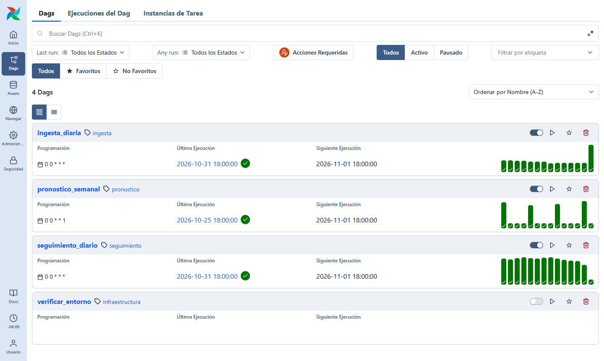
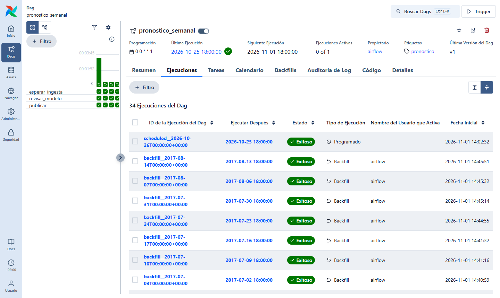

# Lab1_PD · Motor de reposición de inventario

Producto de ML que, en cada fecha de corte, transforma las ventas que llegan a diario en:

1. **Pronóstico** de ventas diarias por tienda y familia de producto, con cuantiles.
2. **Pedido sugerido** al centro de distribución, según los costos de quiebre y merma
   definidos en [`config/params.yaml`](config/params.yaml).
3. **Seguimiento** del desempeño de los pronósticos ya publicados.

Stack: Git + GitHub Actions · DVC · Apache Airflow 3 (Docker Compose) · Python.

> Versión entregada: tag `entrega-lab1`. Decisiones técnicas y de producto en
> [DECISIONES.md](DECISIONES.md).

## Requisitos

- Git y Docker Desktop (con WSL2 en Windows), con al menos 4 GB de RAM asignados.
- Los datos de la competencia
  [Store Sales – Time Series Forecasting](https://www.kaggle.com/competitions/store-sales-time-series-forecasting/data).

## Puesta en marcha desde cero

Solo se necesitan Docker y los CSV de Kaggle:

```bash
git clone https://github.com/Rodricsls/Lab1_PD.git && cd Lab1_PD
```

1. Colocar en **`data/kaggle/`** estos cinco archivos de Kaggle, sin renombrar:
   `train.csv`, `stores.csv`, `holidays_events.csv`, `oil.csv`, `transactions.csv`.
2. Solo en Linux: para que los archivos generados queden a nombre de su usuario,

   ```bash
   echo "AIRFLOW_UID=$(id -u)" > .env
   ```

3. Levantar todo:

   ```bash
   docker compose up -d --build
   ```

   Al arrancar, el servicio `bandeja-init` construye la carga histórica y la bandeja a
   partir de esos CSV (≈ 1–2 min la primera vez) y solo entonces arranca Airflow. Si
   faltan archivos o columnas, `bandeja-init` falla con un mensaje que dice cuál:
   `docker compose logs bandeja-init`.

- Interfaz: <http://localhost:8080> · usuario `airflow`, contraseña `airflow`.
- El DAG `verificar_entorno` (manual) comprueba que Airflow importa el paquete, lee
  `config/params.yaml` y que la bandeja está montada en solo lectura.
- Detener: `docker compose down` (agregar `-v` para borrar también los metadatos).

### Ejecutar el flujo sobre un periodo

Activar los DAGs (un backfill no avanza sobre un DAG pausado) y lanzar ambos backfills;
pueden correr al mismo tiempo: el pronóstico de cada lunes espera a que la ingesta haya
procesado todas las llegadas hasta esa fecha.

```bash
docker compose exec airflow-scheduler airflow dags unpause ingesta_diaria
docker compose exec airflow-scheduler airflow dags unpause pronostico_semanal
docker compose exec airflow-scheduler airflow dags unpause seguimiento_diario
docker compose exec airflow-scheduler airflow backfill create --dag-id ingesta_diaria --from-date 2017-01-01 --to-date 2017-08-16 --max-active-runs 8
docker compose exec airflow-scheduler airflow backfill create --dag-id pronostico_semanal --from-date 2017-01-02 --to-date 2017-08-14 --max-active-runs 1
docker compose exec airflow-scheduler airflow backfill create --dag-id seguimiento_diario --from-date 2017-01-02 --to-date 2017-08-16 --max-active-runs 8
```

Para otro periodo basta cambiar las fechas (la ingesta, diaria; el pronóstico, los lunes).
Al activarlos, Airflow crea además una corrida para la fecha de hoy: la ingesta no
encuentra archivos (aviso) y el pronóstico se omite porque la bandeja no tiene datos.

| DAG | Cuándo | Qué hace |
|---|---|---|
| `ingesta_diaria` | diario | Ingiere la carga inicial (una vez) y, por fuente, lo que llegó a la bandeja en la fecha lógica; valida y registra en `data/historico/`. Un archivo inválido deja en rojo la tarea de su fuente y no entra; las situaciones esperadas quedan como avisos en `data/historico/_reportes/llegada=D/`. |
| `pronostico_semanal` | lunes | Espera la ingesta, **prepara los datos** (vista point-in-time de cada fuente en `data/procesado/fecha_corte=D/`), revisa el modelo cada 4 semanas (backtest + criterio de reemplazo, registro en `modelos/registro.json`) y publica pronóstico, pedido y metadata en `publicados/fecha_corte=D/`. |
| `seguimiento_diario` | diario | Compara cada pronóstico publicado con las ventas reales conocidas a la fecha (incluidas correcciones): WAPE, cobertura, nivel de servicio del pedido y costo de negocio, en `publicados/_seguimiento/al=D/resumen.csv`. |

Salidas de cada publicación:

| Archivo | Contenido |
|---|---|
| `pronostico.parquet` | Venta diaria por tienda × familia para 14 días, cuantiles 0.10 / 0.50 / 0.75 / 0.90 |
| `pedido.parquet` | Pedido sugerido diario (cuantil crítico 0.75 con los costos actuales) |
| `pedido_semana.csv` | Total sugerido por tienda × familia para la semana del pedido |
| `metadata.json` | Modelo y fecha en que se entrenó, commit de Git, costos y cuantil crítico usados |

### Desarrollo local (opcional)

```bash
python -m venv .venv
.venv/Scripts/pip install -r requirements-dev.txt dvc -e .   # Linux/macOS: .venv/bin/pip
.venv/Scripts/python -m pytest -q
.venv/Scripts/python -m reposicion.bandeja      # misma generación que bandeja-init
```

## Bandeja: el sistema de origen simulado

La bandeja se organiza por **fecha de llegada**, de modo que en una fecha lógica D el
flujo ve solo lo que había llegado hasta D:

```
data/bandeja/carga_inicial/<fuente>.csv                         lo llegado hasta el corte (con fecha_llegada)
data/bandeja/<fuente>/llegada=AAAA-MM-DD/<fuente>_<clave>.csv   entregas diarias
data/bandeja/_manifiesto.csv                                    cada versión entregada
```

| Fuente | Origen en Kaggle | Llega |
|---|---|---|
| `ventas` | `train.csv` (sin `onpromotion`) | D+1 |
| `transacciones` | `transactions.csv` | D+2 |
| `petroleo` | `oil.csv` (solo días hábiles) | D+1 |
| `promociones` | `onpromotion` de `train.csv` | 14 días antes de D |
| `feriados` | `holidays_events.csv`, un archivo por mes | día 15 del mes anterior |
| `tiendas` | `stores.csv` | en la carga inicial |

- **Corte histórico:** 2016-12-31; la bandeja llega hasta la última fecha de `train.csv`.
  Si los CSV traen más fechas, la bandeja se extiende sola.
- **Correcciones:** el mismo archivo en una carpeta de llegada posterior; gana la llegada
  más reciente. Se generan de dos formas: ≈ 2 % de los archivos de ventas llegan primero
  con errores y se corrigen 2–5 días después (simulado, con semilla), y si un CSV de Kaggle
  cambia entre ejecuciones, las fechas afectadas se entregan de nuevo como corrección.
- Todos estos valores están en la sección `bandeja` de `config/params.yaml`.
  Diseño y alternativas: [DECISIONES.md](DECISIONES.md) (D4).

## Estructura

```
config/            parámetros versionados (costos, horizonte, cuantiles, umbrales)
src/reposicion/    lógica del producto (bandeja, ingesta, validación, features, modelos,
                   pedido, producción, seguimiento, reproducción)
dags/              DAGs de Airflow (solo orquestan)
tests/             pruebas con datos sintéticos (pytest, corren en GitHub Actions)
data/              kaggle, bandeja, histórico, procesado (DVC) · ver data/README.md
modelos/           registro y artefactos de modelos (DVC)
publicados/        pronósticos, pedidos y seguimiento emitidos (DVC)
reportes/          comparación de modelos y seguimiento (Markdown)
docs/evidencia/    capturas de Airflow
```

## Versionado de datos

DVC con un remoto local (carpeta fuera del repositorio, ver D1). Se versionan
`data/kaggle`, `data/bandeja`, `data/historico`, `data/procesado`, `modelos/` y
`publicados/`; Git guarda
solo los punteros `.dvc`. El remoto local no viaja con el repositorio: quien clona
reconstruye todo desde los CSV de Kaggle con el flujo de arriba.

## Reproducción de un pronóstico pasado

Cada publicación guarda en su `metadata.json` el commit y la revisión del modelo que la
produjeron. Para reproducirla basta el código de un commit y los datos que DVC asocia a
ese commit. Prueba realizada en un *worktree* limpio, en el tag que versiona la
operación 2017 (`operacion-2017`), recuperando los datos desde el remoto DVC:

```bash
git worktree add ../lab1-repro operacion-2017
cd ../lab1-repro
dvc pull data/historico.dvc modelos.dvc publicados.dvc
#   2382 files fetched and 2379 files added
python -m reposicion.reproducir --fecha-corte 2017-03-06
python -m reposicion.reproducir --fecha-corte 2017-03-06 --reentrenar
python -m reposicion.reproducir --fecha-corte 2017-07-03 --reentrenar
```

| Pronóstico | Modelo (entrenado) | Cómo | Filas | Máx. diferencia | Resultado |
|---|---|---|---|---|---|
| 2017-03-06 | LightGBM (2017-02-27) | modelo guardado en DVC | 24,948 | 1.8 × 10⁻¹² | idéntico |
| 2017-03-06 | LightGBM (2017-02-27) | **reentrenado desde el histórico** | 24,948 | 1.8 × 10⁻¹² | idéntico |
| 2017-07-03 | Baseline (2017-06-19) | reentrenado desde el histórico | 24,948 | 0 | idéntico |

Salida del segundo comando:

```json
{
  "fecha_corte": "2017-03-06",
  "commit_publicacion": "e9f35ff5a6dc6cc340c9bf262ec237c92f8761f1",
  "modelo": "lightgbm",
  "modelo_entrenado": "2017-02-27",
  "reentrenado": true,
  "filas": 24948,
  "mismas_llaves": true,
  "max_diferencia_abs": 1.8189894035458565e-12,
  "identico": true
}
```

`commit_publicacion` es el commit con que corrió Airflow (tag `publicacion-2017`, de la
rama del PR #6, integrada en `main` por squash). La diferencia de 10⁻¹² es redondeo de punto flotante: la vista del
histórico en la fecha de corte reconstruye exactamente la información de entonces y
LightGBM corre en modo determinista.

## Evidencia de funcionamiento

Operación completa de 2017 ejecutada desde cero (metadatos de Airflow, bandeja, histórico
y modelos borrados), con los tres backfills lanzados a la vez. La UI muestra las fechas en
hora local (UTC−6): la corrida del lunes 2017-08-14 00:00 UTC aparece como 2017-08-13 18:00.

| DAG | Corridas | Estado |
|---|---|---|
| `ingesta_diaria` | 229 (2017-01-01 → 2017-08-16) | todas exitosas |
| `pronostico_semanal` | 33 lunes (2017-01-02 → 2017-08-14) | todas exitosas · 9 revisiones de modelo |
| `seguimiento_diario` | 227 (2017-01-02 → 2017-08-16) | todas exitosas |




Más capturas en [docs/evidencia/](docs/evidencia/): resumen y ejecuciones de cada DAG y el
backfill del pronóstico.

### Comparación de modelos

Backtest temporal con 4 cortes (lunes, cada 28 días, mayo–julio de 2017), los mismos para
ambos modelos. Reporte completo: [reportes/comparacion_modelos.md](reportes/comparacion_modelos.md).

| Modelo | WAPE P50 | Pinball rel. | Cobertura P10–P90 | Costo de negocio |
|---|---|---|---|---|
| Baseline (mismo día, 8 semanas) | 0.144 | 0.051 | 69 % | 12.70 M |
| **LightGBM cuantílico** | **0.133** | **0.044** | **78 %** | **11.24 M (−11.5 %)** |

En la operación, el criterio de reemplazo eligió LightGBM en enero, cambió al baseline en
la revisión del 24 de abril (lo superó en el backtest) y volvió a LightGBM el 14 de agosto
(`modelos/registro.json`, D8).

Reproducir: `python -m reposicion.modelos --fecha-final 2017-08-16` (requiere el histórico
ingerido).

### Seguimiento del desempeño

33 pronósticos publicados comparados con las ventas reales al 2017-08-16. Reporte por
publicación: [reportes/seguimiento.md](reportes/seguimiento.md).

| Indicador | Valor |
|---|---|
| Nivel de servicio del pedido (días en que cubrió la venta) | **74.9 %** (objetivo: 75 %, el cuantil crítico) |
| Cobertura del intervalo P10–P90 | 70.5 % (nominal 80 %) |
| WAPE del P50 (media por publicación) | 0.168 |
| Costo de negocio por unidad vendida | 0.31 |

El pedido queda calibrado al nivel de servicio que fijan los costos. Las semanas más débiles
son las tres primeras de enero (efecto de fin de año en la historia reciente, WAPE
0.23–0.40); desde febrero el WAPE se mueve entre 0.11 y 0.19. Las dos últimas
publicaciones aún tienen el horizonte incompleto (9 y 2 días observados).
